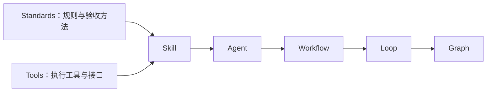
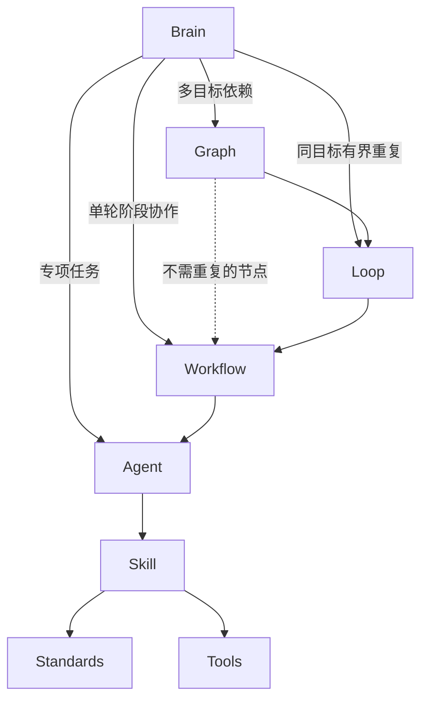
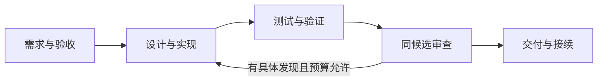

**目的**：说明本框架的用途、组装关系、调用入口与可采用的真实执行路径。

**适用于**：希望采用 Java/Spring AI 研发方法的开发者与助手；运行前须核各后端条件和当前授权。

# ai-java-workflow

**面向 Java / Spring Boot 业务开发的 AI 研发工作流（AI for Java / AI for Spring）。** 提供从需求、实现、测试到审查与交付的方法、工具和虚构可运行案例；本项目不是 Spring AI 框架实现或教程。

## 20 个 Agent 角色怎么用

仓库提供 **20 份可按需采用的 Agent 职责说明**。每个角色都写明接收什么、交付什么，以及怎样核对结果。单项任务可直接选角色，涉及多阶段交接时可从 Brain 选工作流。[查看完整 Agent 目录](agents/README.md) · [开始自己的任务](brain/README.md)

| 你要做什么 | 可选角色 | 你会拿到什么 |
| --- | --- | --- |
| 把需求推进到可实施 | 需求负责人、方案作者、方案复核者、模块规划者 | 验收条件、技术方案、复核发现和模块分工 |
| 实现并验证 Java/Spring 改动 | 实现者、验证者、Java 构建执行者 | 代码差异、实际测试结果和行为保留证据 |
| 审查改动是否符合预期 | 代码审查者、语义审查者、原则审查者 | 具体问题位置、反例和整改条件 |
| 诊断故障或复核已有结论 | 证据采集者、诊断者、结论复核者 | 可追溯证据、可能解释和能区分它们的检查 |
| 安排交付或接续未完任务 | 任务协调者、交付规划者 | 阶段进度、交付顺序、未决项和恢复条件 |

- **Spring 批量归档**。从需求、设计复核和模块规划走到实现，核对非法条目会不会造成部分写入。正确候选通过全部 14 项测试，包含真实 Spring / MockMvc 场景，并由分离上下文独立重跑验证。[阅读清单归档案例](examples/design-to-spring/README.md)
- **原生 Agent 协作**。在 macOS 的 Codex CLI 中，6 个原生子 Agent 完成需求澄清、实现、独立验证、并行审查和交付报告，最终 25 项离线 Spring 测试通过。[原生 Spring 研发案例](examples/native-spring-workflow/README.md)

## 框架架构

Brain 负责逐轮路由与接续，**可调取 Agent 及其上的 Workflow、Loop、Graph**。框架的组装关系是：

**原子规则（Standards）与执行工具（Tools）平级 → Skill → Agent → Workflow → Loop → Graph**

Standards 提供规则、方法与验收判据，Tools 提供程序、控制器与执行接口；Skill 组合适配两者，Agent 承担决策、执行与结果责任。组装层级与任务调用入口分别表示：



任务调用时，Brain 从 Graph → Loop → Workflow → Agent 判断哪层适合当前任务，并直接进入选中的合同、模板或已有实例。完整能力架构也在 [Brain 入口](brain/README.md)显示：



**Brain 可以选择 Graph、Loop、Workflow、Agent；Skill、Standards、Tools 由 Agent 使用。** 高层组织下层，不要求每个任务启用所有层。任务协调者协助所选组织实例运行，不是进入组织层的强制前置；阶段 Agent 不反向重启同一总体任务。以上为方法与调用约定，现有 CLI 没有自动读取 Brain 路由或拦截调用者身份。

| 组成 | 解决什么问题 | 仓库中的例子 |
| --- | --- | --- |
| **Brain** | 恢复任务与变化，选择组织层或专项 Agent，核收返回 | [任务路由与接续](brain/README.md) |
| **原子规则 / Standards** | 一项方法在什么条件下适用，如何操作、验收，何时停止 | [复用与旧行为保留](standards/behavior-preservation.md) |
| **Tools（与 Standards 平级）** | 哪个实际接口或程序完成执行、控制与证据处理 | [工具目录](tools/README.md) |
| **Skill** | 怎样组合 Standards 与 Tools，把输入适配为具体产物 | [代码实现 Skill](skills/code-implementation/SKILL.md) |
| **Agent** | 谁承担任务、选择能力，对结果和交接负责 | [实现者 Agent](agents/implementer.md) |
| **Workflow** | 一个任务分哪些阶段，各角色如何交接与处理失败 | [Java/Spring 研发 Workflow](workflows/java-spring-development.md) |
| **Loop** | 怎样组织同一目标的多轮 Workflow，预算是否允许，何时收敛或停止 | [审查整改收敛](loops/review-convergence.md) |
| **Graph** | 多个 Loop 与 Workflow 怎样依赖、并行、汇合，失败时阻断哪些后续节点 | [目标 Graph](graphs/goal-graph.md) |

一个 Skill 可以组合多项原子方法与执行工具，一个 Agent 可以按任务采用多个 Skill，一个 Workflow 可以组织多个 Agent，Loop 组织同一目标的多轮 Workflow，Graph 再组织多个 Loop 与 Workflow 的依赖和并发。完整层级不要求每次全部启用：无需重复时可直接采用 Workflow，无多目标依赖时无需 Graph。原子方法保持单源，角色和流程引用它，不重复复制正文；原子规则本身不启动 Agent 或上层流程。

例如，在[书签标签替换案例](examples/workflow-bookmark-tags/README.md)中，Workflow 把实现阶段交给实现者，Agent 采用代码实现 Skill，Skill 复用行为保留、最小改动和验证方法，形成候选与证据，再交验证、审查和交付阶段。需要多个 Workflow 并发时才使用 Graph；有具体发现且需要重复时才采用 Loop。

Tools 的执行支撑包括[工具与隔离机制](tools/execution/README.md)和[原生派工适配器](docs/native-agent-adapter.md)：**worktree 隔离代码工作区，sandbox 约束执行环境**。Docker 是 sandbox 的一种可选后端，具体支持范围见下方运行说明。方法文档、原生角色注册与后端执行能力分别说明，不能据目录或角色文件存在认定已经自动运行。

## Workflow、Loop、Graph 的模板与执行文件

三层统一保留两类文件夹，都是可由 Agent 选用并执行的组织能力：

| 层级 | templates：复用格式 | examples：已填执行文件与案例 | 执行职责 |
| --- | --- | --- | --- |
| Workflow | [阶段与交接模板](workflows/templates/README.md) | [单轮执行文件](workflows/examples/README.md) | 组织一轮需求、实现、验证、审查与交付 |
| Loop | [预算与收敛模板](loops/templates/README.md) | [多轮执行文件](loops/examples/README.md) | 重复同一目标的 Workflow，控制累计预算和停止 |
| Graph | [目标与依赖模板](graphs/templates/README.md) | [目标图执行文件](graphs/examples/README.md) | 组织 Loop/Workflow 的依赖、并发、门禁与整体收口 |

Brain 选择适用组织入口与模板 → 当前协调者/宿主和阶段职责接受任务 → 绑定当前输入、候选、授权、责任和预算，保存执行文件 → 执行、记录结果并向 Brain 返回。续作使用原实例与有效证据，不重建或清零预算。模板不填进度；执行文件记录具体任务与实际状态。真实工程实例写到使用者授权位置，公开 examples 保留独立虚构案例及明确运行状态。

每层均可由 Agent 按合同手动组织执行；已有程序只支持各自定义的格式和环境。examples 包含可运行控制案例和标记 NOT_RUN 的计划，Markdown 模板不会自动变为可运行配置，填表也不表示执行完成。已有真实代码、回执与运行器保持原位置，层内执行文件引用这些证据，避免复制。

## 按完整能力线采用

新增方法按 **Agent → Skill → Standards / Tools** 接入，每条线保留责任、方法、产物和验证；Brain 可选择这些专项 Agent，也可先进入组织它们的 Workflow、Loop 或 Graph：

| 当前阶段 | Agent | Skill | 原子与工具 |
| --- | --- | --- | --- |
| 从准入需求编制设计 | [方案作者](agents/design-author.md) | [技术方案](skills/technical-design/SKILL.md) | 输入/来源、实质设计、旧行为保持 |
| 冻结设计专业复核 | [设计复核者](agents/design-reviewer.md) | [专业复核](skills/technical-design-review/SKILL.md) | 候选绑定、风险反例、发现与定向复核 |
| 从设计生成模块包 | [模块规划者](agents/module-planner.md) | [实施规划](skills/module-planning/SKILL.md) | 有效需求归属、唯一写者、边界和依赖；离线结构检查 |

[技术方案 Workflow](workflows/technical-design.md)和[模块规划 Workflow](workflows/design-to-modules.md)组织阶段交接；[贯通虚构案例](workflows/examples/design-to-modules/README.md)展示发现、修订与模块包。设计/复核部分是作者构造的文档推演，模块工具实际运行正例及拒绝场景；没有新模型、独立审验、Java实现或部署通过声明。

专项任务可选相应 Agent；多阶段任务可先选 Workflow，同目标重复选 Loop，多目标依赖选 Graph。准备规划、结构有效、专业接受和实施许可分别核对，`STRUCTURE_VALID` 不能当作“可以实施”。

新[阅读清单归档案例](examples/design-to-spring/README.md)实际贯通新需求、设计分离复核、3模块准备、Spring实现及独立重跑：每版本14测试，红色负控制指定3失败、当前绿色14全过。旧设计案例原来的 NOT_RUN 保留，不倒填历史。

## 证据采集与覆盖

新增[证据采集者 Agent](agents/evidence-collector.md) → [采集 Skill](skills/evidence-collection/SKILL.md) → [EC01–EC04 原子](standards/evidence-collection.md)及覆盖 Tools：固定来源与版本，保真记录，区分 sample/complete，核零命中的实际覆盖。多阶段可由 Brain 选择[取证 Workflow](workflows/evidence-collection.md)。

[八场景离线案例](workflows/examples/evidence-coverage/README.md)实际判断显式页观察。采样命中不宣称完整，无正控制的零命中保未解决；预算或截断保 PARTIAL，拒权与未知不当作零条。工具不发请求、不认证真实来源，不提供生产连接器或自动补证客户端。[本地文件适配案例](workflows/examples/local-evidence/README.md)现可实际读取明确批准的公开文件集合，核原字节身份、路径/预算和覆盖；仍不扫描私人目录或接通生产服务。

## SQL 查询审查

[查询审查者](agents/query-reviewer.md)现可沿 SQL Skill 采用八类访问模式方法，分别核连接、批量读取、索引、分页、排序、约束及分片。[四条 SQL 内存实验](workflows/examples/sql-query-patterns/README.md)实际核查询次数与结果语义，覆盖零子项、JOIN后分页、UTC日期边界及拟议/已安装唯一约束。MySQL计划与性能按目标环境另行验证。

## 重要结论的反证审查

[结论复核者 Agent](agents/conclusion-reviewer.md) → [结论反证 Skill](skills/conclusion-challenge/SKILL.md) → [CH01–CH04 原子](standards/conclusion-challenge.md)及结构 Tools，组织合理竞争解释、共同证据矩阵、主动反证和决定性证据移除分析。多阶段可选[反证 Workflow](workflows/conclusion-challenge.md)，报告空表放在其 templates。

[实际离线案例](workflows/examples/conclusion-challenge/README.md)运行虚构缓存程序：底层保留写入而缓存仍返回旧值，推翻“读旧值就说明写入丢失”的初始判断。工具只检查报告结构与候选，不能判定根因、事实真实性或实施许可；案例推理由作者编写，未运行独立模型审查或生产诊断。

[能力补齐执行文档](docs/next-capabilities-plan.md)记录五项队列、每步验收、实际结果和接续点；逐项验证、核收并保存真实恢复点。

## 统一运行与有限效果评估

[统一命令](docs/cli.md)提供 doctor、显式目标 choose、run、status、resume，复用五个白名单案例；跨进程保原输入/实现身份，成功不重跑，未知不自动重放。运行目录在仓库外，实际 Spring 入口已执行；这不是任意工程调度器，也不提供 Brain 调用身份认证。

```sh
python3 -B scripts/workflow.py doctor
python3 -B scripts/workflow.py choose --goal challenge
```

[能力评估者](agents/capability-evaluator.md)经评估 Skill 采用可比性原子及[实际结构基准](workflows/examples/capability-benchmark/README.md)。8个作者固定标注任务中，完整合同检查8个正确，明确简化的字段基线3个正确、5个漏检；原始观察、计时和脚本还原可重算。该微型对照不测真实模型效果、人工返工或工程收益，不能推广为总体提升幅度。

## 文档维护与原子覆盖

每份新建或维护文档都须说明具体目的与适用对象。原子规则在 [PUR01/PUR02](standards/document-purpose.md) 单源维护，由[文档维护 Skill](skills/document-maintenance/SKILL.md)消费；[文档维护者](agents/document-maintainer.md)负责写入与依据，[文档审查者](agents/document-reviewer.md)核同候选内容。

本次同时补入原子属性、按需加载、执行记录与接续、上下文拆解、文档保留五类方法。当前定义、导航和模板在正文前声明；已发布案例与历史原件保持原字节，归档目的和适用说明见 `docs/document-contract-index.json`，不能用新格式倒改历史。默认八项检查已包含声明结构和保全字节核对，结构通过不代语义验收。

[原子方法覆盖盘点](docs/atomic-method-coverage.md)列明本轮补齐、既有覆盖、部分覆盖及未纳入的通用方法。盘点限定本轮来源与读取深度，不表示私人框架已经全部迁入，也不会自动启动教练、生产采集或发布流程。

## 可以用它做什么

- **接续任务并选择职责**：识别继续、纠正、范围变化与停止，复用已有流程、责任人和有效证据。
- **把需求变成可实施任务**：明确验收口径、已有行为和允许改动的范围。
- **实现并验证 Java/Spring 变更**：复用既有能力，形成最小差异，用真实测试核对结果。
- **在同一份候选上审查**：区分代码正确性、业务语义、原则和文档，整改后复验受影响部分。
- **并行推进独立任务**：按执行实例分配 worktree 与 sandbox，依赖满足后再集成。
- **交付可接续的结果**：保留候选身份、实际验证、未决项与恢复条件。

## 从 Brain 开始处理自己的任务

在能读取本地文件的助手中打开仓库，输入：

```text
请先读 brain/README.md，再按 brain/routing.md 处理我的需求：……
恢复已有目标、阶段、候选和授权，按需要选择 Graph、Loop、Workflow 或 Agent；
沿选中组织层交接，Agent 经 Skill 采用规则与工具，复用有效证据，只补影响下一步的缺项。
实际写入前确认工程、允许写集与验收；交付时列实际验证、未决和恢复点。
```

[逐轮书签示例](brain/example.md)展示解释、修改、继续、整改与停止的不同路由；[能力地图](brain/capabilities.md)连接现有执行入口与验证来源。Brain 当前是文档路由，由助手或使用者采用；现有运行器尚未自动消费它，不提供常驻监听或自动派工。

## 先从一个案例开始

首次使用，建议先阅读[书签标签替换案例](examples/workflow-bookmark-tags/README.md)。它贯穿同一需求：测试暴露错误 → 定位原因 → 最小修复 → 复验 → 审查 → 交付。案例运行过真实 Spring / MockMvc 测试，具体命令、结果与环境要求均在案例内。

### 1. 获取仓库并检查文档

需要 Git 和 Python 3.9+：

```sh
git clone https://github.com/Lanqiao-Luca/ai-java-workflow.git
cd ai-java-workflow
python3 -B scripts/check_all.py
```

这一步运行八项离线仓库检查，核对公开文件清单、文档引用、案例身份与记录，并执行 Loops 控制判定测试。不调用模型、不构建 Java 工程；任一检查失败即停止并返回非零状态。

### 2. 让当前 AI 助手审阅案例

在能读取本地文件的编程助手中打开仓库，输入：

```text
请先将本任务交给文档审查者 Agent，
由它读取 workflows/java-spring-development.md
与 examples/workflow-bookmark-tags/README.md。
沿需求、实现、验证、审查和交付说明这条案例如何闭环，
区分实际运行的证据与尚未验证的范围。
本次只审阅案例，不修改全局配置、不连接服务、不提交或发布。
```

采用方法文档无需安装插件。阅读 Agent 文件不会自动注册原生角色；自动调度需要下方运行后端的环境和授权。

### 3. 用于自己的需求

```text
请由任务协调者 Agent 接受我的需求：……
由它核对实际工程、验收口径、允许写集和已有改动，
选择本仓库适用的 Java/Spring 研发 Workflow 及阶段 Agent；各 Agent 经 Skill 使用规则和工具。
保留未要求改变的行为，完成实现、必要验证和同候选审查。
交付时列明实际测试、未验证项及接续条件；外部写入按我当前授权处理。
```

## 选择使用方式

| 使用方式 | 适合的任务 | 从这里开始 |
| --- | --- | --- |
| 任务路由与跨轮接续 | 判断任务变化、选择已有组织方式和责任人 | [Brain](brain/README.md)、[最小交接空表](brain/handoff-template.md) |
| 单项方法与角色 | 澄清需求、实现一个改动、诊断或审查 | [Agent 目录](agents/README.md)、[十条角色案例](examples/README.md) |
| 完整研发 Workflow | 从一个业务需求走到可审核交付 | [流程合同](workflows/java-spring-development.md)、[Spring 案例](examples/workflow-bookmark-tags/README.md) |
| 原生 Agent 自动调度 | 六个真实子 Agent 上下文协作，双审查并发 | [原生 Graph](graphs/native-java-spring.md)、[完整运行案例](examples/native-spring-workflow/README.md) |
| 多 Workflow 并发 | 独立 worktree、资源配额与集成依赖 | [并发 Graph](graphs/concurrent-java.md)、[Java 案例](examples/concurrent-java-graph/README.md) |
| Maven / Gradle 构建 | 并发构建与集成验收 | [构建 Graph](graphs/spring-build.md)、[Spring Boot 案例](examples/spring-build-graph/README.md) |
| Docker 容器构建 | 在明确容器限制下执行 Spring Boot 构建 | [Docker Graph](graphs/docker-spring.md)、[双宿主案例](examples/docker-spring-graph/README.md) |
| 有限重复与停止 | 技术失败重试、审查整改的控制方法 | [Loops 目录](loops/README.md)、[本批次交付计划](docs/loops-extraction-plan.md) |

## 一条研发链怎样推进



这张图描述研发任务的阶段推进。各阶段按上面的框架架构选择职责与方法；简单任务可以直接从所需 Agent 开始，不要求启用全部层级。

| 目录 | 内容 |
| --- | --- |
| [brain](brain/README.md) | 任务路由、能力地图与接续交接 |
| [standards](standards/README.md) / [tools](tools/README.md) | 平级的规则方法与执行工具 |
| [skills](skills/README.md) | 组合规则和工具，适配任务输入输出 |
| [agents](agents/README.md) / [workflows](workflows/README.md) | 角色职责与阶段交接 |
| [graphs](graphs/README.md) / [loops](loops/README.md) | 依赖并发与有限重复控制 |
| [examples](examples/README.md) | 独立虚构案例及其证据 |
| [执行机制](tools/execution/README.md) / [原生接口](docs/native-agent-adapter.md) | worktree、沙箱与原生派工参考 |

## 运行支持与当前边界

[通用目标 Graph](graphs/goal-graph.md)现可组织巡检与缺陷 Loop，提供依赖、分支隔离、安全检查点、证据 Gate 和显式收口。[双目标虚构案例](graphs/examples/goal-loops/README.md)可直接运行；[Loop 状态](docs/loop-status.md)与[Graph 状态](docs/graph-status.md)分别保留未迁入和未验事项。

方法、空表可以人工采用；运行后端各有环境要求：

| 后端 | 已验证范围 | 使用前注意 |
| --- | --- | --- |
| 原生 Agent 链路 | macOS、Codex CLI、Maven；完整 Spring 案例 | 需要正常模型登录与网络；宿主会保存项目信任登记，须有相应许可 |
| macOS 严格前台沙箱 | 纯 Java 并发案例 | 实验性 `sandbox-exec` 后端，拒绝 fork，不能跑 Maven / Gradle |
| macOS 可信构建沙箱 | Maven / Gradle 的 Spring Boot 案例 | 允许派生构建进程，loopback 边界较宽，限可信工程 |
| Docker 沙箱 | macOS 控制器及 Linux VM 内控制器实跑 | 需明确本地 Engine 和受审镜像；详见案例的限制及未验平台 |

原生链路现可通过[恢复入口](docs/native-recovery.md)对确认的测试/审查失败有界整改，并在安全检查点续跑；未知结果仍停止。GitHub CI 持续运行离线回归和公开 Spring 候选测试。构建沙箱的隔离验证也不覆盖原生模型后端。示例不连接公司服务或真实业务数据库；生产部署、真实认证、负载与任意工程兼容性由使用者另行验证。

本地可运行 `python3 -B scripts/check_ci.py` 验证恢复与续跑边界；真实模型恢复链路与模拟控制测试分别核证。[巡检收敛](loops/inspection-convergence.md)支持保留缺证的 PARTIAL 退出；[整体缺陷收敛](loops/defect-convergence.md)要求测试、行为、发现关闭及交接全部满足。两者各有可直接运行的虚构控制案例。完整离线检查命令和各模式证据见[验证指南](docs/validation-guide.md)。每个案例保留自己的真实状态，历史 NOT_RUN 不会因为另一个案例通过而变成成功。

## 参与改进

欢迎补充可复核的方法、改进案例或报告具体问题。修改前阅读[协作约定](AGENTS.md)，保持方法单源，更新 `public-manifest.json`，运行受影响检查，明确未运行的部分。

公共案例使用独立虚构材料；公司代码、内部接口、真实数据、凭证和私有会话不得进入仓库。详见[内容与许可边界](RIGHTS.md)。

## 许可

本仓库重新编写的文档、脚本与虚构示例采用 [MIT 许可证](LICENSE)。许可不扩展到使用者的公司代码或其他第三方材料。
