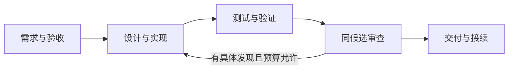

# ai-java-workflow

**面向 Java / Spring 业务开发的 AI 研发工作流。**

让 AI 从理解需求开始，沿着实现、验证、审查与交付推进；每一步都有输入、产物和可核对的验收依据。

你可以只采用一个 Agent 的方法，也可以运行完整的原生 Agent 链路，或让 Graph 并发调度多个 Workflow。仓库提供通用方法、空白模板、执行参考和独立虚构案例，便于按自己的工程条件组合使用。

## 可以用它做什么

- **把需求变成可实施任务**：明确验收口径、已有行为和允许改动的范围。
- **实现并验证 Java/Spring 变更**：复用既有能力，形成最小差异，用真实测试核对结果。
- **在同一份候选上审查**：区分代码正确性、业务语义、原则和文档，整改后复验受影响部分。
- **并行推进独立任务**：按执行实例分配 worktree 与 sandbox，依赖满足后再集成。
- **交付可接续的结果**：保留候选身份、实际验证、未决项与恢复条件。

## 先从一个案例开始

首次使用，建议先阅读[书签标签替换案例](examples/workflow-bookmark-tags/README.md)。它贯穿同一需求：测试暴露错误 → 定位原因 → 最小修复 → 复验 → 审查 → 交付。案例运行过真实 Spring / MockMvc 测试，具体命令、结果与环境要求均在案例内。

### 1. 获取仓库并检查文档

需要 Git 和 Python 3.9+：

```sh
git clone https://github.com/Lanqiao-Luca/ai-java-workflow.git
cd ai-java-workflow
python3 -B scripts/check.py
```

这一步离线检查公开文件清单、文档引用与案例身份，不调用模型、不构建 Java 工程。

### 2. 让当前 AI 助手审阅案例

在能读取本地文件的编程助手中打开仓库，输入：

```text
请先读 workflows/java-spring-development.md，
再读 examples/workflow-bookmark-tags/README.md。
沿需求、实现、验证、审查和交付说明这条案例如何闭环，
区分实际运行的证据与尚未验证的范围。
本次只审阅案例，不修改全局配置、不连接服务、不提交或发布。
```

采用方法文档无需安装插件。阅读 Agent 文件不会自动注册原生角色；自动调度需要下方运行后端的环境和授权。

### 3. 用于自己的需求

```text
按本仓库的 Java/Spring 研发 Workflow 处理我的需求：……
先核对实际工程、验收口径、允许写集和已有改动，按需要选择 Agent 与 Skill。
保留未要求改变的行为，完成实现、必要验证和同候选审查。
交付时列明实际测试、未验证项及接续条件；外部写入按我当前授权处理。
```

## 选择使用方式

| 使用方式 | 适合的任务 | 从这里开始 |
| --- | --- | --- |
| 单项方法与角色 | 澄清需求、实现一个改动、诊断或审查 | [Agent 目录](agents/README.md)、[十条角色案例](examples/README.md) |
| 完整研发 Workflow | 从一个业务需求走到可审核交付 | [流程合同](workflows/java-spring-development.md)、[Spring 案例](examples/workflow-bookmark-tags/README.md) |
| 原生 Agent 自动调度 | 六个真实子 Agent 上下文协作，双审查并发 | [原生 Graph](graphs/native-java-spring.md)、[完整运行案例](examples/native-spring-workflow/README.md) |
| 多 Workflow 并发 | 独立 worktree、资源配额与集成依赖 | [并发 Graph](graphs/concurrent-java.md)、[Java 案例](examples/concurrent-java-graph/README.md) |
| Maven / Gradle 构建 | 并发构建与集成验收 | [构建 Graph](graphs/spring-build.md)、[Spring Boot 案例](examples/spring-build-graph/README.md) |
| Docker 容器构建 | 在明确容器限制下执行 Spring Boot 构建 | [Docker Graph](graphs/docker-spring.md)、[双宿主案例](examples/docker-spring-graph/README.md) |
| 有限重复与停止 | 技术失败重试、审查整改的控制方法 | [Loops 目录](loops/README.md)、[本批次交付计划](docs/loops-extraction-plan.md) |

## 工作流怎样组成



Graph 选择目标、依赖与并发；Workflow 串联一次执行的阶段；Agent 对职责结果负责；Skill 适配任务；Standards 保存共用方法。Loops 为必要的重复提供预算、进展判断和停止条件。简单任务可以直接从所需角色开始。

| 目录 | 内容 |
| --- | --- |
| [standards](standards/README.md) / [skills](skills/README.md) | 原子方法与任务适配 |
| [agents](agents/README.md) / [workflows](workflows/README.md) | 角色职责与阶段交接 |
| [graphs](graphs/README.md) / [loops](loops/README.md) | 依赖并发与有限重复控制 |
| [examples](examples/README.md) | 独立虚构案例及其证据 |
| [执行机制](tools/execution/README.md) / [原生接口](docs/native-agent-adapter.md) | worktree、沙箱与原生派工参考 |

## 运行支持与当前边界

方法、空表可以人工采用；运行后端各有环境要求：

| 后端 | 已验证范围 | 使用前注意 |
| --- | --- | --- |
| 原生 Agent 链路 | macOS、Codex CLI、Maven；完整 Spring 案例 | 需要正常模型登录与网络；宿主会保存项目信任登记，须有相应许可 |
| macOS 严格前台沙箱 | 纯 Java 并发案例 | 实验性 `sandbox-exec` 后端，拒绝 fork，不能跑 Maven / Gradle |
| macOS 可信构建沙箱 | Maven / Gradle 的 Spring Boot 案例 | 允许派生构建进程，loopback 边界较宽，限可信工程 |
| Docker 沙箱 | macOS 控制器及 Linux VM 内控制器实跑 | 需明确本地 Engine 和受审镜像；详见案例的限制及未验平台 |

原生链路遇失败仍停止，Loops 文档不会自动为其开启整改重跑或后台任务。构建沙箱的隔离验证也不覆盖原生模型后端。示例不连接公司服务或真实业务数据库；生产部署、真实认证、负载与任意工程兼容性由使用者另行验证。

完整离线检查命令和各模式证据见[验证指南](docs/validation-guide.md)。每个案例保留自己的真实状态，历史 NOT_RUN 不会因为另一个案例通过而变成成功。

## 参与改进

欢迎补充可复核的方法、改进案例或报告具体问题。修改前阅读[协作约定](AGENTS.md)，保持方法单源，更新 `public-manifest.json`，运行受影响检查，明确未运行的部分。

公共案例使用独立虚构材料；公司代码、内部接口、真实数据、凭证和私有会话不得进入仓库。详见[内容与许可边界](RIGHTS.md)。

## 许可

本仓库重新编写的文档、脚本与虚构示例采用 [MIT 许可证](LICENSE)。许可不扩展到使用者的公司代码或其他第三方材料。
