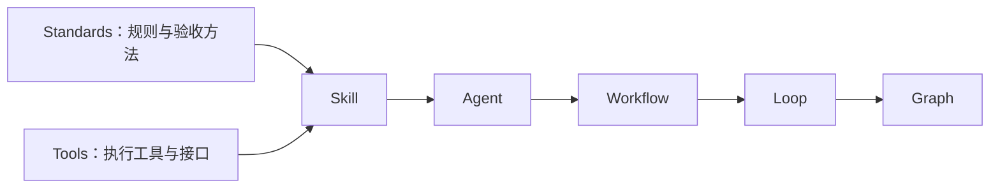
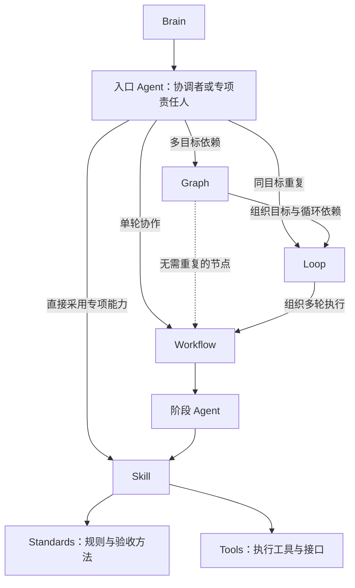
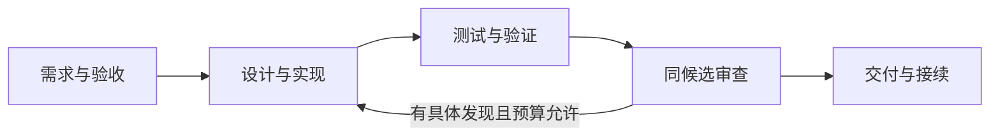

# ai-java-workflow

**面向 Java / Spring 业务开发的 AI 研发工作流。**

让 AI 从理解需求开始，沿着实现、验证、审查与交付推进；每一步都有输入、产物和可核对的验收依据。

通过 [Brain 任务入口](brain/README.md)，先恢复当前任务并交给责任 Agent，再由 Agent 选择流程与具体方法。你可以只采用一个 Agent 的方法，也可以运行完整的原生 Agent 链路，或让 Graph 组织多个 Loop 与 Workflow 的依赖和并发。仓库提供通用方法、空白模板、执行参考和独立虚构案例，便于按自己的工程条件组合使用。

## 框架架构

Brain 负责逐轮路由与接续，**只把任务交给 Agent**。框架的组装关系是：

**原子规则（Standards）与执行工具（Tools）平级 → Skill → Agent → Workflow → Loop → Graph**

Standards 提供规则、方法与验收判据，Tools 提供程序、控制器与执行接口；Skill 组合适配两者，Agent 承担决策、执行与结果责任。组装层级与任务调用入口分别表示：



任务调用时，Brain 只进入 Agent。组织任务交[任务协调者](agents/task-coordinator.md)，专项任务交对应 Agent；由接受任务的 Agent 调取所需层级：



**Brain 不直接调用 Workflow、Loop、Graph、Skill、Standards 或 Tools。** Agent 可以选择任一适用组织层执行；流程内部继续按 Graph → Loop → Workflow → 阶段 Agent 组合，不必每次启用所有层。入口协调 Agent 与阶段执行 Agent 分工明确，阶段 Agent 不反向重启同一总体任务。此处是助手与使用者遵循的调用约定，现有 CLI 不具备调用者身份拦截。

| 组成 | 解决什么问题 | 仓库中的例子 |
| --- | --- | --- |
| **Brain** | 恢复任务与变化，交给责任 Agent，核收返回 | [任务路由与接续](brain/README.md) |
| **原子规则 / Standards** | 一项方法在什么条件下适用，如何操作、验收，何时停止 | [复用与旧行为保留](standards/behavior-preservation.md) |
| **Tools（与 Standards 平级）** | 哪个实际接口或程序完成执行、控制与证据处理 | [工具目录](tools/README.md) |
| **Skill** | 怎样组合 Standards 与 Tools，把输入适配为具体产物 | [代码实现 Skill](skills/code-implementation/SKILL.md) |
| **Agent** | 谁承担任务、选择能力，对结果和交接负责 | [实现者 Agent](agents/implementer.md) |
| **Workflow** | 一个任务分哪些阶段，各角色如何交接与处理失败 | [Java/Spring 研发 Workflow](workflows/java-spring-development.md) |
| **Loop** | 怎样组织同一目标的多轮 Workflow，预算是否允许，何时收敛或停止 | [审查整改收敛](loops/review-convergence.md) |
| **Graph** | 多个 Loop 与 Workflow 怎样依赖、并行、汇合，失败时阻断哪些后续节点 | [目标 Graph](graphs/goal-graph.md) |

一个 Skill 可以组合多项原子方法与执行工具，一个 Agent 可以按任务采用多个 Skill，一个 Workflow 可以组织多个 Agent，Loop 组织同一目标的多轮 Workflow，Graph 再组织多个 Loop 与 Workflow 的依赖和并发。完整层级不要求每次全部启用：无需重复时可直接采用 Workflow，无多目标依赖时无需 Graph。原子方法保持单源，角色和流程引用它，不重复复制正文；原子规则本身不启动 Agent 或上层流程。

例如，在[书签标签替换案例](examples/workflow-bookmark-tags/README.md)中，Workflow 把实现阶段交给实现者，Agent 采用代码实现 Skill，Skill 复用行为保留、最小改动和验证方法，形成候选与证据，再交验证、审查和交付阶段。需要多个 Workflow 并发时才使用 Graph；有具体发现且需要重复时才采用 Loop。

Tools 的执行支撑包括[工具与隔离机制](tools/execution/README.md)和[原生派工适配器](docs/native-agent-adapter.md)：**worktree 隔离代码工作区，sandbox 约束执行环境**。Docker 是 sandbox 的一种可选后端，具体支持范围见下方运行说明。方法文档、原生角色注册与后端执行能力分别说明，不能据目录或角色文件存在认定已经自动运行。

## Workflow、Loop、Graph 的模板与执行文件

三层统一保留两类文件夹，都是可由 Agent 选用并执行的组织能力：

| 层级 | templates：复用格式 | examples：已填执行文件与案例 | 执行职责 |
| --- | --- | --- | --- |
| Workflow | [阶段与交接模板](workflows/templates/README.md) | [单轮执行文件](workflows/examples/README.md) | 组织一轮需求、实现、验证、审查与交付 |
| Loop | [预算与收敛模板](loops/templates/README.md) | [多轮执行文件](loops/examples/README.md) | 重复同一目标的 Workflow，控制累计预算和停止 |
| Graph | [目标与依赖模板](graphs/templates/README.md) | [目标图执行文件](graphs/examples/README.md) | 组织 Loop/Workflow 的依赖、并发、门禁与整体收口 |

Agent 接受任务 → 选择所需层与模板 → 绑定当前输入、候选、授权、责任和预算，保存执行文件 → 执行、记录结果并向 Brain 返回。续作使用原实例与有效证据，不重建或清零预算。模板不填进度；执行文件记录具体任务与实际状态。真实工程实例写到使用者授权位置，公开 examples 保留独立虚构案例及明确运行状态。

每层均可由 Agent 按合同手动组织执行；已有程序只支持各自定义的格式和环境。examples 包含可运行控制案例和标记 NOT_RUN 的计划，Markdown 模板不会自动变为可运行配置，填表也不表示执行完成。已有真实代码、回执与运行器保持原位置，层内执行文件引用这些证据，避免复制。

## 可以用它做什么

- **接续任务并选择职责**：识别继续、纠正、范围变化与停止，复用已有流程、责任人和有效证据。
- **把需求变成可实施任务**：明确验收口径、已有行为和允许改动的范围。
- **实现并验证 Java/Spring 变更**：复用既有能力，形成最小差异，用真实测试核对结果。
- **在同一份候选上审查**：区分代码正确性、业务语义、原则和文档，整改后复验受影响部分。
- **并行推进独立任务**：按执行实例分配 worktree 与 sandbox，依赖满足后再集成。
- **交付可接续的结果**：保留候选身份、实际验证、未决项与恢复条件。

## 从 Brain 开始处理自己的任务

在能读取本地文件的助手中打开仓库，输入：

```text
请先读 brain/README.md，再按 brain/routing.md 处理我的需求：……
恢复已有目标、阶段、候选和授权，先交给任务协调者或专项 Agent；
由 Agent 选择 Workflow、Loop、Graph 的模板和执行文件，经 Skill 采用规则与工具，复用有效证据，只补影响下一步的缺项。
实际写入前确认工程、允许写集与验收；交付时列实际验证、未决和恢复点。
```

[逐轮书签示例](brain/example.md)展示解释、修改、继续、整改与停止的不同路由；[能力地图](brain/capabilities.md)连接现有执行入口与验证来源。Brain 当前是文档路由，由助手或使用者采用；现有运行器尚未自动消费它，不提供常驻监听或自动派工。

## 先从一个案例开始

首次使用，建议先阅读[书签标签替换案例](examples/workflow-bookmark-tags/README.md)。它贯穿同一需求：测试暴露错误 → 定位原因 → 最小修复 → 复验 → 审查 → 交付。案例运行过真实 Spring / MockMvc 测试，具体命令、结果与环境要求均在案例内。

### 1. 获取仓库并检查文档

需要 Git 和 Python 3.9+：

```sh
git clone https://github.com/Lanqiao-Luca/ai-java-workflow.git
cd ai-java-workflow
python3 -B scripts/check_all.py
```

这一步运行八项离线仓库检查，核对公开文件清单、文档引用、案例身份与记录，并执行 Loops 控制判定测试。不调用模型、不构建 Java 工程；任一检查失败即停止并返回非零状态。

### 2. 让当前 AI 助手审阅案例

在能读取本地文件的编程助手中打开仓库，输入：

```text
请先将本任务交给文档审查者 Agent，
由它读取 workflows/java-spring-development.md
与 examples/workflow-bookmark-tags/README.md。
沿需求、实现、验证、审查和交付说明这条案例如何闭环，
区分实际运行的证据与尚未验证的范围。
本次只审阅案例，不修改全局配置、不连接服务、不提交或发布。
```

采用方法文档无需安装插件。阅读 Agent 文件不会自动注册原生角色；自动调度需要下方运行后端的环境和授权。

### 3. 用于自己的需求

```text
请由任务协调者 Agent 接受我的需求：……
由它核对实际工程、验收口径、允许写集和已有改动，
选择本仓库适用的 Java/Spring 研发 Workflow 及阶段 Agent；各 Agent 经 Skill 使用规则和工具。
保留未要求改变的行为，完成实现、必要验证和同候选审查。
交付时列明实际测试、未验证项及接续条件；外部写入按我当前授权处理。
```

## 选择使用方式

| 使用方式 | 适合的任务 | 从这里开始 |
| --- | --- | --- |
| 任务路由与跨轮接续 | 判断任务变化、选择已有组织方式和责任人 | [Brain](brain/README.md)、[最小交接空表](brain/handoff-template.md) |
| 单项方法与角色 | 澄清需求、实现一个改动、诊断或审查 | [Agent 目录](agents/README.md)、[十条角色案例](examples/README.md) |
| 完整研发 Workflow | 从一个业务需求走到可审核交付 | [流程合同](workflows/java-spring-development.md)、[Spring 案例](examples/workflow-bookmark-tags/README.md) |
| 原生 Agent 自动调度 | 六个真实子 Agent 上下文协作，双审查并发 | [原生 Graph](graphs/native-java-spring.md)、[完整运行案例](examples/native-spring-workflow/README.md) |
| 多 Workflow 并发 | 独立 worktree、资源配额与集成依赖 | [并发 Graph](graphs/concurrent-java.md)、[Java 案例](examples/concurrent-java-graph/README.md) |
| Maven / Gradle 构建 | 并发构建与集成验收 | [构建 Graph](graphs/spring-build.md)、[Spring Boot 案例](examples/spring-build-graph/README.md) |
| Docker 容器构建 | 在明确容器限制下执行 Spring Boot 构建 | [Docker Graph](graphs/docker-spring.md)、[双宿主案例](examples/docker-spring-graph/README.md) |
| 有限重复与停止 | 技术失败重试、审查整改的控制方法 | [Loops 目录](loops/README.md)、[本批次交付计划](docs/loops-extraction-plan.md) |

## 一条研发链怎样推进



这张图描述研发任务的阶段推进。各阶段按上面的框架架构选择职责与方法；简单任务可以直接从所需 Agent 开始，不要求启用全部层级。

| 目录 | 内容 |
| --- | --- |
| [brain](brain/README.md) | 任务路由、能力地图与接续交接 |
| [standards](standards/README.md) / [tools](tools/README.md) | 平级的规则方法与执行工具 |
| [skills](skills/README.md) | 组合规则和工具，适配任务输入输出 |
| [agents](agents/README.md) / [workflows](workflows/README.md) | 角色职责与阶段交接 |
| [graphs](graphs/README.md) / [loops](loops/README.md) | 依赖并发与有限重复控制 |
| [examples](examples/README.md) | 独立虚构案例及其证据 |
| [执行机制](tools/execution/README.md) / [原生接口](docs/native-agent-adapter.md) | worktree、沙箱与原生派工参考 |

## 运行支持与当前边界

[通用目标 Graph](graphs/goal-graph.md)现可组织巡检与缺陷 Loop，提供依赖、分支隔离、安全检查点、证据 Gate 和显式收口。[双目标虚构案例](graphs/examples/goal-loops/README.md)可直接运行；[Loop 状态](docs/loop-status.md)与[Graph 状态](docs/graph-status.md)分别保留未迁入和未验事项。

方法、空表可以人工采用；运行后端各有环境要求：

| 后端 | 已验证范围 | 使用前注意 |
| --- | --- | --- |
| 原生 Agent 链路 | macOS、Codex CLI、Maven；完整 Spring 案例 | 需要正常模型登录与网络；宿主会保存项目信任登记，须有相应许可 |
| macOS 严格前台沙箱 | 纯 Java 并发案例 | 实验性 `sandbox-exec` 后端，拒绝 fork，不能跑 Maven / Gradle |
| macOS 可信构建沙箱 | Maven / Gradle 的 Spring Boot 案例 | 允许派生构建进程，loopback 边界较宽，限可信工程 |
| Docker 沙箱 | macOS 控制器及 Linux VM 内控制器实跑 | 需明确本地 Engine 和受审镜像；详见案例的限制及未验平台 |

原生链路现可通过[恢复入口](docs/native-recovery.md)对确认的测试/审查失败有界整改，并在安全检查点续跑；未知结果仍停止。GitHub CI 持续运行离线回归和公开 Spring 候选测试。构建沙箱的隔离验证也不覆盖原生模型后端。示例不连接公司服务或真实业务数据库；生产部署、真实认证、负载与任意工程兼容性由使用者另行验证。

本地可运行 `python3 -B scripts/check_ci.py` 验证恢复与续跑边界；真实模型恢复链路与模拟控制测试分别核证。[巡检收敛](loops/inspection-convergence.md)支持保留缺证的 PARTIAL 退出；[整体缺陷收敛](loops/defect-convergence.md)要求测试、行为、发现关闭及交接全部满足。两者各有可直接运行的虚构控制案例。完整离线检查命令和各模式证据见[验证指南](docs/validation-guide.md)。每个案例保留自己的真实状态，历史 NOT_RUN 不会因为另一个案例通过而变成成功。

## 参与改进

欢迎补充可复核的方法、改进案例或报告具体问题。修改前阅读[协作约定](AGENTS.md)，保持方法单源，更新 `public-manifest.json`，运行受影响检查，明确未运行的部分。

公共案例使用独立虚构材料；公司代码、内部接口、真实数据、凭证和私有会话不得进入仓库。详见[内容与许可边界](RIGHTS.md)。

## 许可

本仓库重新编写的文档、脚本与虚构示例采用 [MIT 许可证](LICENSE)。许可不扩展到使用者的公司代码或其他第三方材料。
