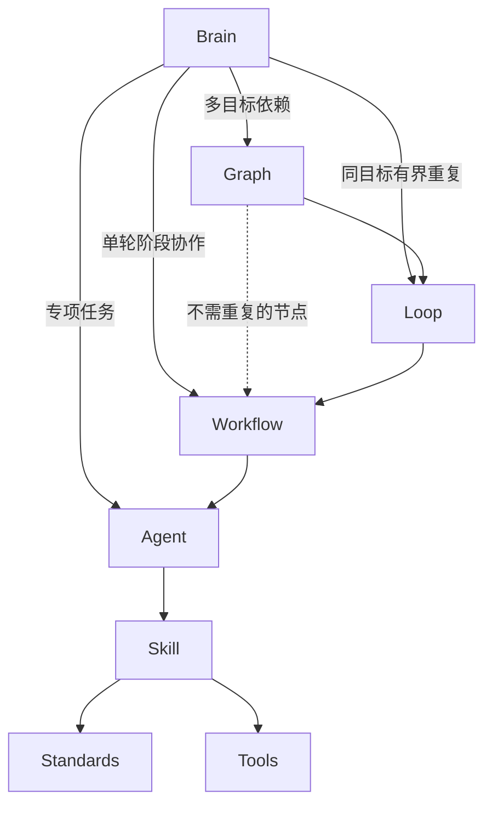

**目的**：展示完整能力架构，按本轮目标选择适用组织入口，并核收实际结果与接续状态。

**适用于**：当前助手的任务路由与续作；可以调取 Agent、Workflow、Loop、Graph，具体方法与工具经 Agent 使用。

# Brain：架构、任务路由与接续

## 完整架构与调用边界

组装关系为：**Standards / Tools（平级）→ Skill → Agent → Workflow → Loop → Graph**。Workflow 组织一轮 Agent 阶段；Loop 组织同一目标的多轮 Workflow；Graph 组织多个 Loop/Workflow 的依赖、并发与汇合。

Brain 位于这套能力架构的路由入口，可以按任务直接选择和调取 **Graph、Loop、Workflow 或 Agent**。判断顺序从 Graph → Loop → Workflow → Agent 逐层看是否需要，实际只启用适用层，不要求每次全用。Skill、Standards 和 Tools 由责任 Agent 经 Skill 消费，Brain 不绕过 Agent 执行这些底层能力。



这里的“调取”指选择并进入相应合同、模板和执行实例，按该层职责组织执行；不表示 Brain 代替 Agent 实现代码、审查成果或执行原子。宿主、当前协调者与阶段 Agent 按实际运行方式承担工作，不因入口选择新建原生进程。

## 每轮怎样使用

1. 恢复目标、工程、阶段、候选、授权与下一步，判断新任务、继续、纠正、范围变化或停止；已有有效信息复用。
2. 对照[路由](routing.md)选择 Graph、Loop、Workflow 或 Agent。已有组织实例继续原入口；不先固定进入 Agent 再反向启动它上面的组织层。
3. 选择组织层时定位其模板与现有实例，绑定当前输入、责任、写集、预算、验收和恢复点；实际持有写权的协调者保存计划后才推进受控动作。高层沿 Graph→Loop→Workflow→Agent 交接，Agent 再经 Skill 使用规则与工具。
4. 核收同候选产物、实际测试、必要审查和剩余目标。Brain 核目标与返回是否完整，具体实现、业务和专业验收仍归对应职责；自查与真实分离上下文分别报告。
5. 续作沿原责任和状态推进，变化仅刷新相交部分；停止终止相关新动作，保留在途未知及恢复条件，不创建后台续跑。

一个任务只有一个总体进度来源，最高实际启用层持有它，局部层只返回本层结果。可将[最小交接空表](handoff-template.md)合并到原记录，不强制另建状态库。

## 使用提示

```text
先读 brain/README.md 和命中的 brain/routing.md 条目。
我的任务是：……
请展示选中的入口及理由，从 Graph、Loop、Workflow、Agent 中按需选择，
复用现有实例、授权、候选和有效证据，不为续作重建计划。
高层组织下层，具体 Skill、规则和工具交给 Agent 使用。
执行前核实际工程、写集和验收；返回实际结果、未决和恢复点。
```

[能力地图](capabilities.md)给出现有组织入口与专项职责，[书签示例](example.md)展示逐轮选择变化。

## 当前能力边界

本目录是可由助手或使用者采用的路由文档，现有运行器没有自动读取这些路由，也没有 Brain/Agent 调用者身份拦截。定义存在、角色注册、宿主可调用、当前授权和实际运行分别核对。

Brain 不创造联网、Git 写入、部署、委派或后台权限。必要来源缺失只暂停依赖动作；历史成功不覆盖当前新候选或未验平台。未知副作用先查受理状态，不通过换实例重放或清零预算。

返回：[项目入口](../README.md)。
